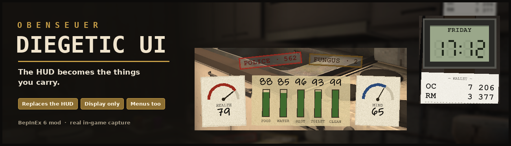

# Obenseuer Diegetic UI

A BepInEx 6 mod for [Obenseuer](https://store.steampowered.com/app/1554640/Obenseuer/) that replaces the HUD with the things your character carries.

## What it shows

- **Needs on masking tape**: Food, Water, Rest, Toilet and Clean as ink gauges (higher = better). Green when full, through olive and mustard to rust and red; under 10 the gauge turns red and pulses.
- **Health and Mind on needle dials**, printed on paper cards either side of the tape.
- **Warnings as rubber stamps**: Bleeding, Police (the real crime value, no cap), Arrest, Radiation (dose / 10), Fungus, cravings (drink, smoke, mushrooms, gambling) and the duck. Severe ones throb.
- **A cheap LCD wristwatch**: the time shows only with a watch equipped and the weekday only with a calendar watch, the game's own rule (in menus, a clock or a charged phone you carry counts).
- **A receipt wallet**: OC and RM balances. Every payment prints a green or red line that fades after a few seconds, and the balance flashes.
- **Typed paper slips** for the game's notifications (tasks, items, mail, money, crime...), with a coloured heading per category. The game's own queue, sounds and 8-second timing are kept.
- **Luggage tags** for the equipped items in the bottom corners, with the item's real icon, battery segments for lights and a wear bar for tools.
- **Menus**: a status clipboard in the free right gutter (live while you eat or drink), a compact watch and receipt, manila folder tabs and a paper label on storage headers (the bank shows "BANK · box 2 of 4").
- **Paper menus**: the menu pages get the desk look - dark frames become cardboard, rows and cards become manila paper with ink text (Tasks, Notes, Character skill cards, the inventory lists). Only colours change; the game's own panels and buttons keep working, item slots/icons, crafting panels and the Tenement blueprint keep the game's look, and turning it off restores every colour.
- **Other mods**: Bank Inventory (search box, crafting/bank buttons) and Loot Map (its map panel) switch to the same paper look when this mod is installed. Each can be turned off.
- Hidden on loading screens, the pause menu, conversations, building mode and whenever the game hides its own HUD.

Display only: the mod reads the game's values and hides the game's HUD pieces it replaces. Nothing about needs, money or saves changes. Turning it off restores the game's HUD.

## Configuration

`BepInEx/config/com.juanberta.obenseuer.diegeticui.cfg`

| Section | Key | Default | |
| --- | --- | --- | --- |
| General | Enabled | true | Off: the game's HUD comes back |
| Parts | NeedsAndWarnings / WatchAndWallet / Notifications / EquippedTags / MenuRestyle / MenuPaperTheme | true | Turn each part on or off |
| Other mods | BankInventoryPaperLook / LootMapPaperLook | true | Paper look for those mods' panels (only if they are installed) |
| Layout | Scale | 0.85 | 0.5 - 1.6 |
| Layout | Opacity | 1 | Gameplay only; menus stay opaque |
| Layout | EdgeMargin / BottomMargin | 24 / 34 | Distance from the screen edges |

## Compatibility

Use only one HUD replacement. If UI Overhaul (or its older Compact HUD build) is installed too, the mod logs a warning and shows a note in menus. Works with Bank Inventory, Recipe Marker, Loot Map, Special Orders and the skill mods.

Troubleshooting: in a menu, hover something that looks wrong and press **Ctrl+F10**; the log gets a line per text/image under the mouse with its colours and what the theme did.

## Install

BepInEx 6 (x64). Extract the archive into the Obenseuer folder so the DLL ends up at `BepInEx/plugins/Obenseuer-DiegeticUI/Obenseuer-DiegeticUI.dll`.

## Building

`dotnet build -c Release` (references the game at `C:\Program Files (x86)\Steam\steamapps\common\Obenseuer`; override with `/p:ObenseuerDir=...`).

## Credits

Design and code by JuanBerta. Written from scratch; inspired by the idea of a cleaner Obenseuer HUD. Fonts come from Windows (Ink Free / Segoe Print for handwriting, Courier New for typed text); none are bundled.

## License

MIT
